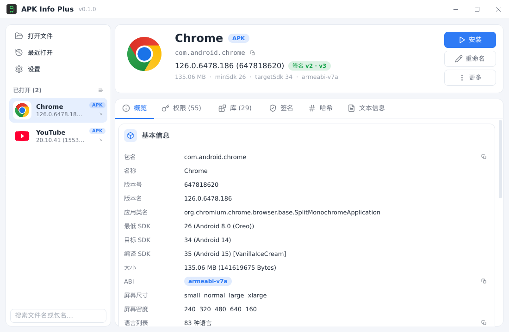

# APK Info Plus

[](https://github.com/huanfeng/ApkInfoPlus/actions/workflows/ci.yml)
[](https://github.com/huanfeng/ApkInfoPlus/releases)
[](LICENSE)

轻量、跨平台（Windows / macOS / Linux）的 Android 安装包查看与安装工具。拖一个 APK / XAPK / APKM / APKS 进来，
包信息、图标、权限、签名证书、用到的第三方 SDK 一眼看全，还能直接装到手机上。

由 Flutter 版 [ApkInfoTool](https://github.com/huanfeng/ApkInfoTool) 用 Rust + [windui](https://github.com/huanfeng/wind-ui-rust) 重写而来：
功能保留并增强，体积、启动速度与内存占用按原生桌面工具的标准重做。

| 概览（Chrome，浅色） | 库识别（YouTube，深色） |
|---|---|
|  |  |

## 亮点

- **解析零依赖**：纯 Rust 解析 AndroidManifest.xml、resources.arsc、签名块与 DEX，不需要 aapt2、apksigner 或 Java；单个可执行文件，Windows 压缩包约 3–4 MB
- **快**：100–200 MB 的 APK 从打开到解析完成（含 DEX 扫描与库识别）在半秒以内
- **看得出用了什么 SDK**：基于 [LibChecker-Rules](https://github.com/LibChecker/LibChecker-Rules) 识别原生库、四大组件与 DEX 包里的第三方 SDK（推送、统计、广告、热修复、Jetpack 等），还能看出 Kotlin / Jetpack Compose / 加固
- **装得上**：多设备、多分包、OBB 一起推，失败原因直接给出；没装 adb 时可在设置里一键下载 platform-tools
- **原生桌面体验**：多文件侧栏、几乎所有字段可选中复制、完整快捷键、单实例、浅色 / 深色主题、6 种界面语言即时切换

## 功能

**包信息**
- APK / XAPK / APKM / APKS（以及装着 APK 的 .zip）：包名、版本、SDK、权限、硬件特性、屏幕尺寸与密度、ABI、语言列表、启动 Activity
- 归档包读取 manifest.json，列出分包（按基础 / 语言 / ABI / 密度分类）与 OBB
- 混淆 APK 容错；应用名可在各语言之间切换；「文本信息」页提供 aapt2 `dump badging` 风格的输出

**图标**
- 位图 / VectorDrawable / adaptive-icon / layer-list / shape 全部渲染，多个候选间切换，导出 PNG / SVG / 原始文件

**签名与校验**
- v1（PKCS#7）与 v2 / v3 / v3.1（APK Signing Block）证书：DN、序列号、有效期、SHA-256 / SHA-1 / MD5 指纹、密钥算法与长度
- 后台流式计算文件 MD5 / SHA1

**库识别**
- 原生库：按 SDK 分组，显示厂商图标、库名与 ABI；未识别的库单独列出并给出大小
- 组件：Activity / Service / Receiver / Provider 按名字或 intent-filter action 命中
- DEX：扫描 `classes*.dex` 定义的类，按包名前缀识别 SDK
- 点开任一 SDK 可看描述、开发团队、来源链接与规则贡献者；规则可在设置里在线更新，设计见 [docs/libchecker.md](docs/libchecker.md)

**安装（adb）**
- 独立安装窗口：多设备、`install` / `install-multiple`、OBB 推送、`-r -d -t -g` 选项、分包勾选、进度日志与取消

**日常使用**
- 拖入 / 命令行 / 再次启动传入的多个文件同时打开，侧栏可搜索、单个或全部关闭，各文件记住停留的标签页
- 文件重命名（预设模板 + 非法字符与同名校验）、复制路径、在文件管理器中显示
- Windows / Linux 可在设置里注册文件关联；macOS 由 .app 声明文档类型
- 界面语言 简体中文 / 繁體中文（台灣、香港）/ English / 日本語 / 한국어，切换即时生效

## 安装

从 [Releases](https://github.com/huanfeng/ApkInfoPlus/releases) 下载：

| 平台 | 文件 |
|---|---|
| Windows x64 | `ApkInfoPlus-<版本>-windows-x86_64.zip`（解压即用） |
| macOS（Apple Silicon / Intel 通用） | `ApkInfoPlus-<版本>-macos-universal.dmg` |
| Linux x64 | `ApkInfoPlus-<版本>-linux-x86_64.AppImage` 或 `.tar.gz` |

Windows 也可以用 [Scoop](https://scoop.sh)：

```powershell
scoop bucket add huanfeng https://github.com/huanfeng/scoop-bucket
scoop install apkinfoplus
```

## 快捷键

| 键 | 作用 |
|---|---|
| Ctrl+O | 打开文件 |
| F5 | 重新解析 |
| Ctrl+I | 安装 |
| F2 | 重命名 |
| Ctrl+W | 关闭当前文件 |
| Ctrl+Tab / Ctrl+Shift+Tab | 切换文件 |
| Ctrl+, | 设置 |
| Esc | 关闭对话框 / 退出 |

## 常见问题

- **macOS 提示「无法打开」**：dmg 只做了 ad-hoc 签名、未经 Apple 公证。第一次在 Finder 里右键「打开」，
  或执行 `xattr -dr com.apple.quarantine "/Applications/APK Info Plus.app"`。
- **Linux 运行依赖**：fontconfig（选字）与 X11 或 Wayland（设 `WINDUI_BACKEND=wayland`），不需要 GTK。
  AppImage 在 Ubuntu 22.04 上构建，需要 glibc 2.35 或更新。
- **安装时找不到设备**：需要 adb。设置 →「工具」里可以选系统 PATH 中的 adb、自定义路径，或一键下载 platform-tools。
- **库识别没结果**：自己从源码构建时要先同步规则（见下文「构建」）；也可以在设置 →「工具」里点「检查更新」下载规则。
  只能识别规则库收录的 SDK，被混淆改名的库识别不出来。

## 构建

`windui` 默认用 crates.io 的发布版。要连同本地的 `wind-ui-rust` 源码一起改，在仓库根目录建
`.cargo/config.toml`（已在 .gitignore 里）：

```toml
[patch.crates-io]
windui = { path = "../wind-ui-rust" }   # 相对仓库根目录
```

Windows 可执行文件的图标由 `crates/app/build.rs` 在构建时嵌入，
需要 `rc.exe` / `llvm-rc` / `windres` 之一在 PATH 里，找不到时只是没有图标。

库识别用的 LibChecker 规则不入库，构建前执行一次同步（CI 与 Release 每次都会拉上游最新版）：

```bash
python3 scripts/sync-libchecker-rules.py      # 生成 crates/core/assets/libchecker/rules.zip，build.rs 内嵌
```

没有规则包也能编译，只是库识别不可用（构建时会有 warning）。设计与匹配语义见 `docs/libchecker.md`。

需要 Rust 1.85+（edition 2021，工作区使用 `std::sync::LazyLock` 等较新 API）。

```bash
cargo build --release -p apkinfoplus          # 桌面应用：target/release/apkinfoplus
cargo run -p apkinfoplus -- path/to/app.apk   # 直接打开文件
cargo run -p apkinfo-core --bin apkinfo -- path/to/app.apk   # 命令行查看解析结果（aapt2 badging 风格）
cargo run -p apkinfo-core --bin apkinfo -- libs path/to/app.apk   # 命令行查看库识别结果
```

调试用参数（不写入配置）：`--lang zh-CN` 强制界面语言，`--theme dark|light` 强制主题，
`--screenshot out.png [--click X Y]` 离屏渲染一帧（windui 提供，用于视觉回归）。

## 仓库结构

```
crates/core   apkinfo-core：解析核心库（zip / axml / arsc / manifest / icon / signature / adb / installer / tools）+ apkinfo 命令行
crates/app    apkinfoplus：windui 桌面应用（ui / state / actions / config / i18n）
packaging/                                                 macOS Info.plist、Linux .desktop
scripts/                                                   版本号同步、LibChecker 规则同步与各平台打包脚本
docs/superpowers/specs/2026-10-21-apkinfoplus-design.md   设计文档
docs/libchecker.md                                         库识别（LibChecker）设计
docs/images/                                               README 截图
```

## 发布

推送 `v*` 标签触发 `.github/workflows/release.yml`：三平台构建打包，创建 GitHub Release，
再通知 [scoop-bucket](https://github.com/huanfeng/scoop-bucket) 更新 manifest（需要仓库 Secret
`SCOOP_BUCKET_GITHUB_TOKEN`，未配置时跳过）。版本号以标签为准，由 `scripts/set-version.py` 写入
`Cargo.toml` 与 Windows 资源。

配置文件位于平台配置目录下的 `apkinfoplus/config.toml`（Linux `~/.config/apkinfoplus/`），
日志与下载的 platform-tools 位于数据目录 `apkinfoplus/`（Linux `~/.local/share/apkinfoplus/`）。

## 测试

```bash
cargo test --workspace                 # 单元测试（含译文一致性 lint）
cargo clippy --workspace --all-targets # 零警告
```

核心库里有几组 `#[ignore]` 的手工对照测试，通过环境变量指向本机文件运行：
`APKINFO_SIG_APK`（签名 vs apksigner）、`APKINFO_INSTALL_APK` + `APKINFO_INSTALL_DEV`（真机安装）、`APKINFO_DL_DIR`（联网下载）。

## 与 Flutter 版的差异

- 解析引擎只保留内置实现，不再提供 aapt2 切换；签名改为证书解析（不做完整性校验），不再需要 apksigner / Java。
- 长列表（权限、分包、签名）改为独立标签页，去掉了「列表最大行数」设置。
- 分包分类修正了 `config.en` 这类语言包被归为「其他」的问题；安装失败会显示 adb 给出的原因（含退出码为 0 但输出 `Failure` 的情况）。
- 重命名会拒绝非法字符与同名覆盖；导出文件名跟随当前选择的应用名语言。
- SVG 导出的 clip-path 真正生效。

## 致谢与许可证

本项目以 MIT 许可证发布。

- 界面基于作者的 [windui](https://github.com/huanfeng/wind-ui-rust)
- 库识别的思路与规则来自 [LibChecker](https://github.com/LibChecker/LibChecker)

库识别内嵌的规则数据与图标来自 [LibChecker-Rules](https://github.com/LibChecker/LibChecker-Rules)，
按 Apache-2.0 分发（发布包内附 `LICENSE-LibChecker-Rules.txt`）；我们只重新打包（合并详情文件、改用压缩），
不修改规则内容。图标为各厂商商标，仅用于标识对应 SDK。
