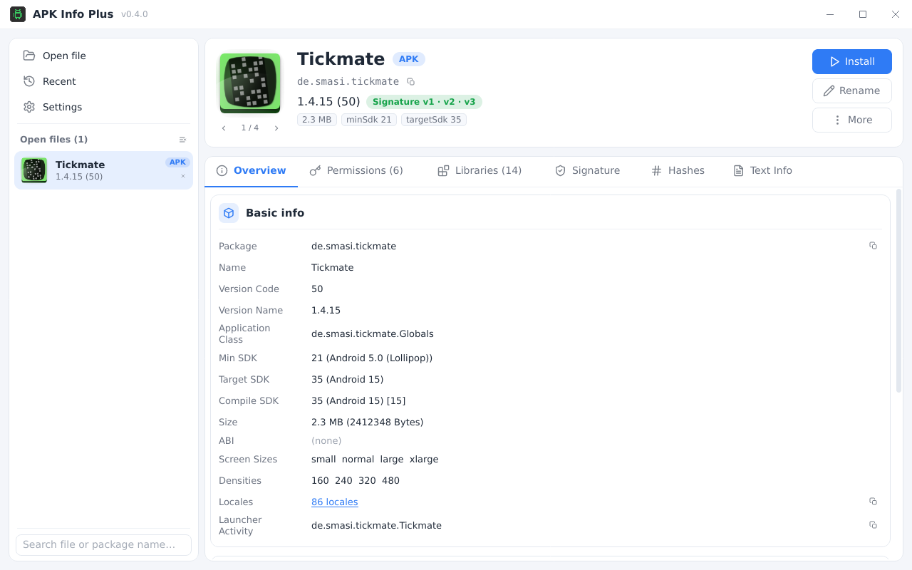
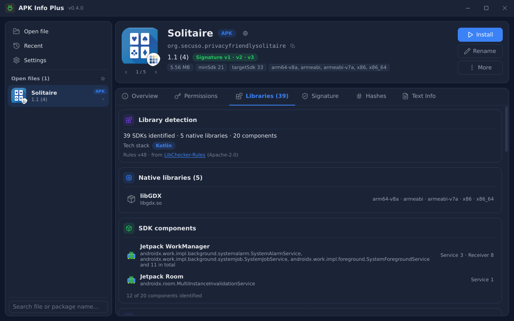

# APK Info Plus

English | [简体中文](README.zh-CN.md)

[](https://github.com/huanfeng/ApkInfoPlus/actions/workflows/ci.yml)
[](https://github.com/huanfeng/ApkInfoPlus/releases)
[](LICENSE)

A lightweight, cross-platform (Windows / macOS / Linux) viewer and installer for Android packages. Drop in an APK / XAPK / APKM / APKS / AAB file and see package details, icons, permissions, signature certificates and third-party SDKs at a glance — and install straight to a connected phone.

A Rust + [windui](https://github.com/huanfeng/wind-ui-rust) rewrite of the Flutter app [ApkInfoTool](https://github.com/huanfeng/ApkInfoTool):
same features with enhancements, rebuilt to native desktop standards for size, startup speed and memory use.

The interface follows the system language automatically — English unless a Chinese locale is detected — and can be switched anytime in Settings (six languages).

| Overview (Chrome, light) | Library detection (YouTube, dark) |
|---|---|
|  |  |

## Highlights

- **Zero-dependency parsing**: pure Rust parsing of AndroidManifest.xml, resources.arsc, signing blocks and DEX — no aapt2, apksigner or Java; a single executable, roughly 3–4 MB in the zipped Windows package
- **Fast**: opening a 100–200 MB APK through parsing (including DEX scan and library identification) takes well under half a second
- **See which SDKs are used**: identifies native libraries, the four component types and third-party SDKs in DEX packages (push, analytics, ads, hot-fix, Jetpack, …) based on [LibChecker-Rules](https://github.com/LibChecker/LibChecker-Rules), and also shows Kotlin / Jetpack Compose / packer detection
- **Installs for real**: multiple devices, split APKs and OBB pushed together, failure reasons given directly; one-click platform-tools download from Settings when adb is missing
- **Native desktop experience**: multi-file sidebar, nearly every field selectable and copyable, full keyboard shortcuts, single instance, light / dark theme, 6 UI languages with instant switching

## Features

**Package info**
- APK / XAPK / APKM / APKS / AAB (and .zip archives containing APKs): package name, version, SDK levels, permissions, hardware features, screen sizes and densities, ABIs, locale list, launcher activity
- AAB is parsed locally, including DEX, native libraries and components in each module. AAB is view-only; the install action applies to APKs and APK archives.
- Archive bundles read manifest.json, listing splits (grouped by base / language / ABI / density) and OBB
- Permissions table: official permission titles and descriptions (in the UI language), sorted by risk level (high / sensitive / normal / system), hover to see the Android protection level
- Locale list opens into per-entry code, name and autonym; hardware / software features carry descriptions and "required / optional"; minSdk / targetSdk hover shows the OS version and release date
- Tolerates obfuscated APK containers; app name can be switched among languages; the "Text Info" page provides aapt2 `dump badging`-style output

**Icons**
- Bitmap / VectorDrawable / adaptive-icon / layer-list / shape all rendered, switch among candidates, export PNG / SVG / raw file

**Signature & checksums**
- v1 (PKCS#7) and v2 / v3 / v3.1 (APK Signing Block) certificates: DN, serial number, validity, SHA-256 / SHA-1 / MD5 fingerprints, key algorithm and length
- Background streaming MD5 / SHA1 of the file

**Library detection**
- Native libraries grouped by SDK with vendor icon, library name and ABI; unidentified libraries listed separately with sizes
- Components: Activity / Service / Receiver / Provider matched by name or intent-filter action
- DEX: scans classes defined in `classes*.dex` and identifies SDKs by package prefix
- Click any SDK for description, developer team, source links and rule contributors; rules can be updated online in Settings, see [docs/libchecker.md](docs/libchecker.md) for the design

**Install (adb)**
- Dedicated install window: multiple devices, `install` / `install-multiple`, OBB push, `-r -d -t -g` options, split selection, progress log and cancel

**Everyday use**
- Multiple files open at once via drag-and-drop / command line / arguments passed to a second launch; searchable sidebar, close one or all, each file remembers its active tab
- File renaming (preset templates, including "name + version + ABI"; invalid characters and name clashes rejected), copy path, show in file manager
- File associations can be registered from Settings on Windows / Linux; on macOS document types are declared by the .app
- UI languages: 简体中文 / 繁體中文（台灣、香港）/ English / 日本語 / 한국어, instant switching

## Installation

Download from [Releases](https://github.com/huanfeng/ApkInfoPlus/releases):

| Platform | File |
|---|---|
| Windows x64 | `ApkInfoPlus-<version>-windows-x86_64.zip` (unzip and run) |
| macOS (Apple Silicon / Intel universal) | `ApkInfoPlus-<version>-macos-universal.dmg` |
| Linux x64 | `ApkInfoPlus-<version>-linux-x86_64.AppImage` or `.tar.gz` |

On Windows, [Scoop](https://scoop.sh) also works:

```powershell
scoop bucket add huanfeng https://github.com/huanfeng/scoop-bucket
scoop install apkinfoplus
```

## Keyboard shortcuts

| Key | Action |
|---|---|
| Ctrl+O | Open file |
| F5 | Reparse |
| Ctrl+I | Install |
| F2 | Rename |
| Ctrl+W | Close current file |
| Ctrl+Tab / Ctrl+Shift+Tab | Switch files |
| Ctrl+, | Settings |
| Esc | Close dialog / quit |

## Troubleshooting

- **macOS says the app "can't be opened"**: the dmg is ad-hoc signed and not notarized by Apple. Right-click → "Open" in Finder the first time, or run
  `xattr -dr com.apple.quarantine "/Applications/APK Info Plus.app"`.
- **Linux runtime dependencies**: fontconfig (font selection) and X11 or Wayland (set `WINDUI_BACKEND=wayland`); GTK is not required.
  The AppImage is built on Ubuntu 22.04 and needs glibc 2.35 or newer.
- **No device found when installing**: adb is required. Settings → "Tools" lets you pick adb from the system PATH, use a custom path, or download platform-tools with one click.
- **Library detection shows nothing**: when building from source, sync the rules first (see "Building" below); you can also click "Check for updates" in Settings → "Tools" to download them.
  Only SDKs covered by the rule set can be identified; libraries renamed by obfuscation cannot be.

## Building

`windui` defaults to the crates.io release. To develop against a local `wind-ui-rust` checkout, create `.cargo/config.toml`
at the repository root (already in .gitignore):

```toml
[patch.crates-io]
windui = { path = "../wind-ui-rust" }   # relative to the repo root
```

The icon for the Windows executable is embedded at build time by `crates/app/build.rs`,
which needs `rc.exe` / `llvm-rc` / `windres` on the PATH; if none is found the build just has no icon.

The LibChecker rules used for library detection are not committed; run the sync once before building
(CI and Release always pull the latest upstream version):

```bash
python3 scripts/sync-libchecker-rules.py      # generates crates/core/assets/libchecker/rules.zip, embedded by build.rs
```

The build still compiles without a rule bundle; library detection is simply unavailable (a warning is shown).

Permission protection levels, per-language permission strings and locale names are generated and committed
(`crates/core/src/android/generated.rs`, `crates/app/i18n/android/`); regenerate them when a new SDK ships, which needs aapt2 and Node:

```bash
python3 scripts/gen-android-data.py           # uses the highest-API android.jar under $ANDROID_HOME by default
```

Rust 1.85+ is required (edition 2021; the workspace uses newer APIs such as `std::sync::LazyLock`).

```bash
cargo build --release -p apkinfoplus          # desktop app: target/release/apkinfoplus
cargo run -p apkinfoplus -- path/to/app.apk   # open a file directly
cargo run -p apkinfo-core --bin apkinfo -- path/to/app.apk   # CLI view of the parse result (aapt2 badging style)
cargo run -p apkinfo-core --bin apkinfo -- libs path/to/app.apk   # CLI view of library detection
```

Debug flags (not persisted to config): `--lang zh-CN` forces the UI language, `--theme dark|light` forces the theme,
`--screenshot out.png [--click X Y]` renders one frame offscreen (provided by windui, for visual regression).

## Repository layout

```
crates/core   apkinfo-core: parsing core library (zip / axml / arsc / manifest / icon / signature / adb / installer / tools) + apkinfo CLI
crates/app    apkinfoplus: windui desktop app (ui / state / actions / config / i18n)
packaging/                                                 macOS Info.plist, Linux .desktop
scripts/                                                   version sync, LibChecker rule sync, Android permission / locale data generation, packaging scripts
docs/superpowers/specs/2026-10-21-apkinfoplus-design.md   design document
docs/libchecker.md                                         library detection (LibChecker) design
docs/images/                                               README screenshots
```

## Releases

Pushing a `v*` tag triggers `.github/workflows/release.yml`: builds and packages on all three platforms, creates the GitHub Release,
then notifies the [scoop-bucket](https://github.com/huanfeng/scoop-bucket) to update its manifest (needs the repo secret
`SCOOP_BUCKET_GITHUB_TOKEN`; skipped when unset). Versions come from the tag, written by `scripts/set-version.py`
into `Cargo.toml` and Windows resources.

The config file lives in `apkinfoplus/config.toml` under the platform config directory (Linux `~/.config/apkinfoplus/`);
logs and downloaded platform-tools live in the data directory `apkinfoplus/` (Linux `~/.local/share/apkinfoplus/`).

## Tests

```bash
cargo test --workspace                 # unit tests (including a translation consistency lint)
cargo clippy --workspace --all-targets # zero warnings
```

The core library has several `#[ignore]` manual comparison tests, run by pointing environment variables at local files:
`APKINFO_SIG_APK` (signature vs apksigner), `APKINFO_INSTALL_APK` + `APKINFO_INSTALL_DEV` (real-device install), `APKINFO_DL_DIR` (network download).

## Differences from the Flutter version

- The parsing engine keeps only the built-in implementation; the aapt2 switch is gone; signature handling became certificate parsing (no integrity verification), removing the apksigner / Java requirement.
- Long lists (permissions, splits, signature) became dedicated tabs; the "max list rows" setting is gone.
- Split classification fixes language packs such as `config.en` being grouped under "Other"; install failures show the reason adb reported (including exit code 0 with a `Failure` line).
- Renaming rejects invalid characters and overwriting an existing name; exported file names follow the currently selected app-name language.
- SVG export clip-path actually takes effect.

## Acknowledgements & License

This project is released under the MIT license.

- The UI is built on the author's [windui](https://github.com/huanfeng/wind-ui-rust)
- Library detection ideas and rules come from [LibChecker](https://github.com/LibChecker/LibChecker)

The rule data and icons embedded for library detection come from [LibChecker-Rules](https://github.com/LibChecker/LibChecker-Rules),
distributed under Apache-2.0 (the release ships a `LICENSE-LibChecker-Rules.txt`); we only repack (merge detail files, switch to a compressed format)
and never modify rule content. Icons are the respective vendors' trademarks, used solely to identify each SDK.
